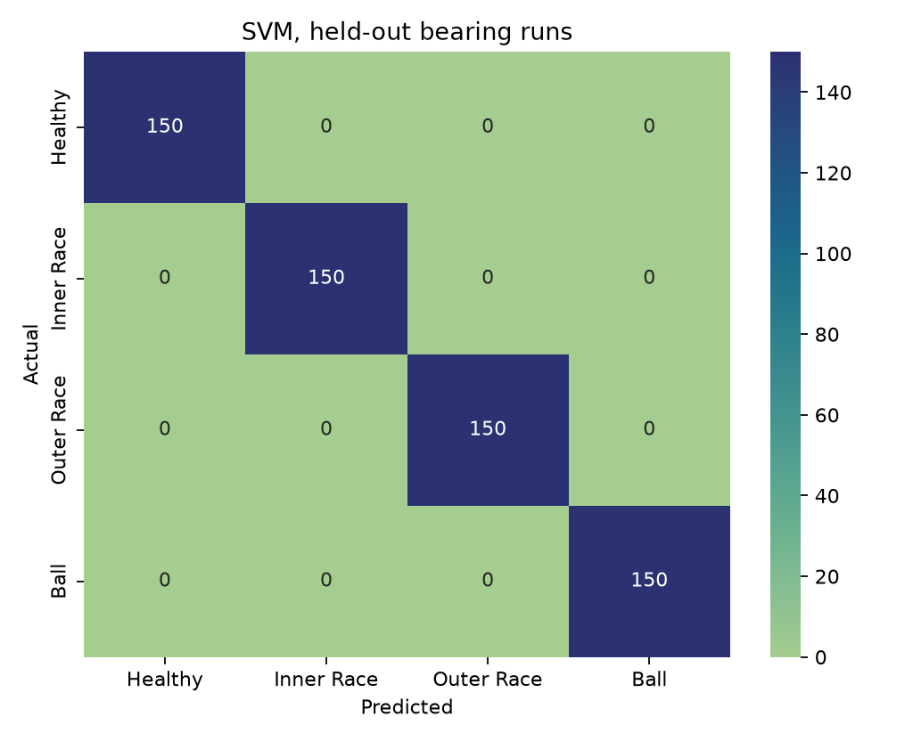
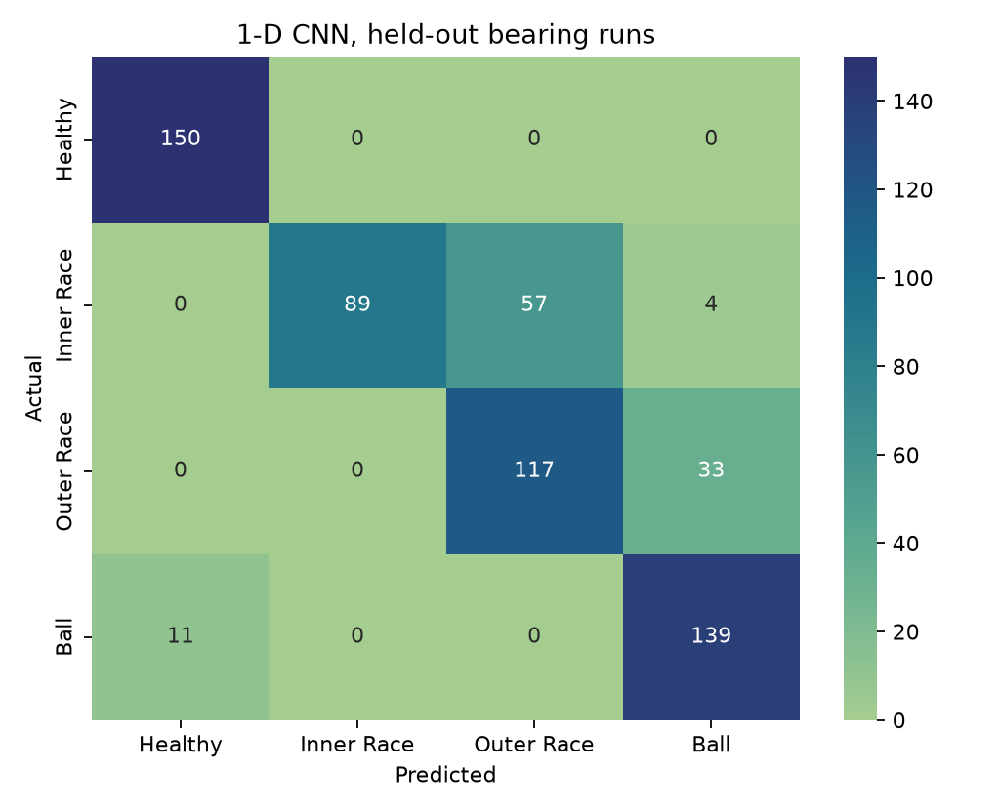
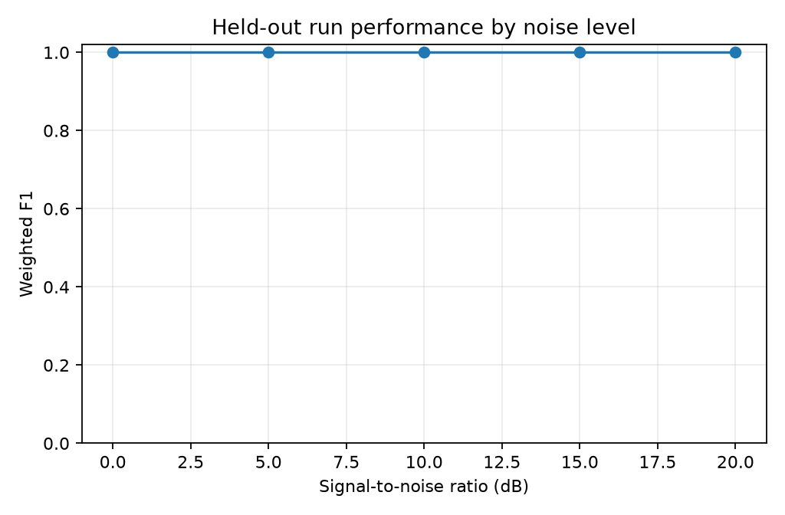
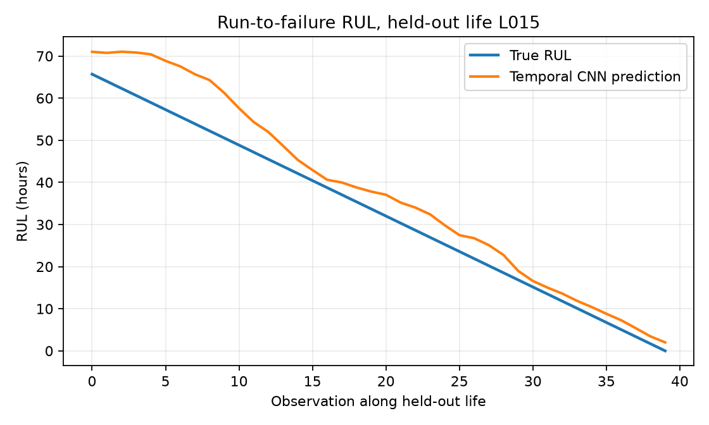

# Physics-Based Simulation and Machine Learning Framework for Rolling Bearing Fault Diagnosis and RUL Estimation

## Abstract

This project builds a deterministic, physics-informed synthetic vibration benchmark and evaluates classical and deep-learning methods for rolling-bearing fault classification and remaining useful life (RUL) estimation. Signals represent a nominal SKF 6205-2RS deep-groove bearing at 12 kHz. Kinematic fault impulses excite a damped structural resonance, with speed-dependent modulation, timing jitter, load variation, and Gaussian plus colored noise. The classification dataset contains 4,000 windows from 80 independent simulated runs. The RUL dataset contains 1,200 observations from 30 simulated lives. Splits are made by run/life rather than by individual windows.

On the held-out bearing runs, the best classical model selected on validation achieved accuracy 1.000, weighted precision 1.000, recall 1.000, and F1 1.000. The temporal CNN RUL model achieved RMSE 12.72 hours and MAE 9.51 hours on held-out lives. **All results in this report are from synthetic simulations; they are not measurements from a physical bearing.**

## 1. Introduction

Rolling bearings support rotating shafts while limiting friction. Localized race or rolling-element damage produces repetitive impacts; the bearing housing and machine structure filter these impacts into measurable vibration. The diagnostic challenge is to infer fault type from noisy measurements and to estimate how much operating life remains before a defined damage threshold.

The project objectives are to implement characteristic-frequency signal synthesis, compare feature-based and raw-waveform diagnosis models, study robustness across noise and operating domains, create progressive run-to-failure trajectories, and evaluate RUL regressors without run-level leakage.

## 2. Literature Review

Bearing vibration diagnosis commonly combines characteristic-frequency analysis, resonance-band envelope demodulation, and statistical indicators. McFadden and Smith model the vibration generated by a localized bearing defect as a sequence of impacts filtered by structural dynamics. Tandon and Choudhury review vibration and acoustic methods for rolling-element defect detection. Randall and Antoni provide a broad tutorial on bearing diagnostics and emphasize that fault frequencies are modulated by operating conditions and transfer paths. Antoni's spectral-kurtosis work motivates selecting frequency bands in which impulsive content is prominent.

Feature-based classifiers are useful on compact datasets and provide a transparent baseline; convolutional networks can learn local patterns directly from waveform samples but require careful split design. Prognostics work emphasizes run-to-failure histories, health indicators, and asymmetric penalties when late RUL predictions are more costly than early ones. This project uses synthetic data to exercise those methods, not to claim field performance.

## 3. Methodology

### 3.1 Bearing model and signals

The nominal 6205 geometry and kinematic formulas are detailed in `docs/theory.md`. At each selected speed, BPFO, BPFI, BSF, and FTF are calculated from rolling-element count, ball diameter, pitch diameter, and contact angle. Fault impacts excite a damped sinusoidal resonance in the 2–4 kHz band. Impact intervals receive 1.5% Gaussian timing jitter. Inner-race and ball faults receive shaft/cage-related amplitude modulation. Load and severity scale impact amplitudes; mixed Gaussian and low-pass colored noise is normalized to the requested 0–20 dB SNR.

### 3.2 Classification protocol

The generated benchmark contains 4,000 4096-sample windows at 12 kHz, with 80 simulated bearing runs. There are 56 training, 12 validation, and 12 test runs. A run belongs to only one split. Classical SVM, Random Forest, KNN, and Gradient Boosting models use engineered time, spectrum, and envelope features. A compact 1-D CNN uses raw signals. Validation weighted F1 selects the classical model; the final held-out test is used for reported estimates.

### 3.3 Degradation and RUL protocol

Thirty simulated histories grow from low initial fault severity toward a 0.90 threshold using an exponential growth curve with log-normal perturbation. Each observation contains a vibration window, noisy severity-derived health indicator, and true RUL in simulated operating hours. Direct age and severity are excluded from model inputs; speed, load, the health indicator, and extracted vibration features are retained. The split is by complete bearing life: 21 training, 4 validation, and 5 test lives. Random Forest and Gradient Boosting regressors are compared with a temporal 1-D CNN over recent feature vectors.

The asymmetric score is Mean exp(-error/10)-1 for early predictions; exp(error/13)-1 for late predictions, error=predicted-true RUL.

## 4. Results

### 4.1 Fault diagnosis

Best classical model (validation-selected): **SVM**. The held-out run comparisons are:

| Model | Accuracy | Weighted precision | Weighted recall | Weighted F1 |
|---|---:|---:|---:|---:|
| SVM | 1.000 | 1.000 | 1.000 | 1.000 |
| Random Forest | 1.000 | 1.000 | 1.000 | 1.000 |
| KNN | 1.000 | 1.000 | 1.000 | 1.000 |
| Gradient Boosting | 1.000 | 1.000 | 1.000 | 1.000 |
| 1-D CNN | 0.825 | 0.848 | 0.825 | 0.821 |

Noise robustness on test windows:

| SNR (dB) | Weighted F1 |
|---:|---:|
| 0 | 1.000 |
| 5 | 1.000 |
| 10 | 1.000 |
| 15 | 1.000 |
| 20 | 1.000 |

The low-speed/load-to-high-speed/load domain test yielded accuracy 0.912 and weighted F1 0.910. This is a deliberately different operational range and should not be conflated with the grouped random operating-condition test.

### 4.2 Remaining useful life

The classical regressor selected on validation RMSE was **Gradient Boosting**. Test-set comparisons are:

| Model | RMSE (h) | MAE (h) | Asymmetric score |
|---|---:|---:|---:|
| Random Forest | 9.92 | 7.37 | 1.362 |
| Gradient Boosting | 10.22 | 7.70 | 1.860 |
| Temporal CNN | 12.72 | 9.51 | 2.097 |

The selected plotted test history is L015.

### 4.3 Real-data validation

Real-data validation was not done. The official archive was not validated: HTTPError: HTTP Error 404: Not Found. The data-generation, labels, splits, and all reported metrics above are synthetic-only. An archive download alone is not treated as model validation.

## 5. Discussion

The benchmark verifies that the complete analysis workflow executes reproducibly and that the generated signals contain defect-related periodic structure. Group-wise splitting is essential because adjacent windows from a single simulated run share speed, load, and random process characteristics. The separate low-to-high operating-domain result exposes sensitivity to covariate shift; noise-level F1 shows how performance changes with SNR. The RUL experiments are constrained by only 30 independent synthetic lives, and the health indicator is derived from the simulated severity process, so the task is substantially cleaner than industrial prognostics.

## 6. Limitations

1. Results are on simulated data only; the simulator cannot capture all rolling contact, lubrication, mounting, sensor, and transfer-path effects.
2. The nominal bearing geometry is used for all signals; manufacturing tolerances, clearance, contact-angle change, and slip distributions are simplified.
3. RUL labels are generated from an assumed exponential severity law and fixed threshold, not observed failure times.
4. The number of independent RUL lives is small. Windows are not independent samples and must not be interpreted as such.
5. The health indicator is a noisy proxy derived from severity and may not transfer to a real sensor pipeline.
6. The model outputs are educational estimates and are not suitable for maintenance decisions without calibrated real-world validation.

## 7. Conclusion and Future Work

The project implements a seeded physics-based vibration generator, characteristic-frequency envelope features, grouped fault classifiers, and run-to-failure RUL models. A reproducible pipeline writes datasets, model artifacts, metrics, and figures. Future work should validate against documented CWRU files and independently collected test-rig data, calibrate the transfer function and noise from measured signals, expand life histories, quantify uncertainty, and evaluate speed/load normalization and domain adaptation.

## References

1. McFadden, P. D., and Smith, J. D. (1984). "Model for the vibration produced by a single point defect in a rolling element bearing." *Journal of Sound and Vibration*, 96(1), 69–82.
2. Tandon, N., and Choudhury, A. (1999). "A review of vibration and acoustic measurement methods for the detection of defects in rolling element bearings." *Tribology International*, 32(8), 469–480.
3. Randall, R. B., and Antoni, J. (2011). "Rolling element bearing diagnostics: A tutorial." *Mechanical Systems and Signal Processing*, 25(2), 485–520.
4. Antoni, J. (2006). "The spectral kurtosis: a useful tool for characterising non-stationary signals." *Mechanical Systems and Signal Processing*, 20(2), 282–307.
5. SKF. *Rolling Bearings Catalogue*, product data for 6205-2RS1 deep-groove ball bearings. SKF Group.
6. ISO 15243:2017. *Rolling bearings — Damage and failures — Terms, characteristics and causes*. International Organization for Standardization.
7. Saxena, A., Goebel, K., Simon, D., and Eklund, N. (2008). "Damage propagation modeling for aircraft engine run-to-failure simulation." *2008 International Conference on Prognostics and Health Management*.
8. Case Western Reserve University, Bearing Data Center. *12k Drive End Bearing Fault Data*. Official data repository, https://engineering.case.edu/bearingdatacenter.
