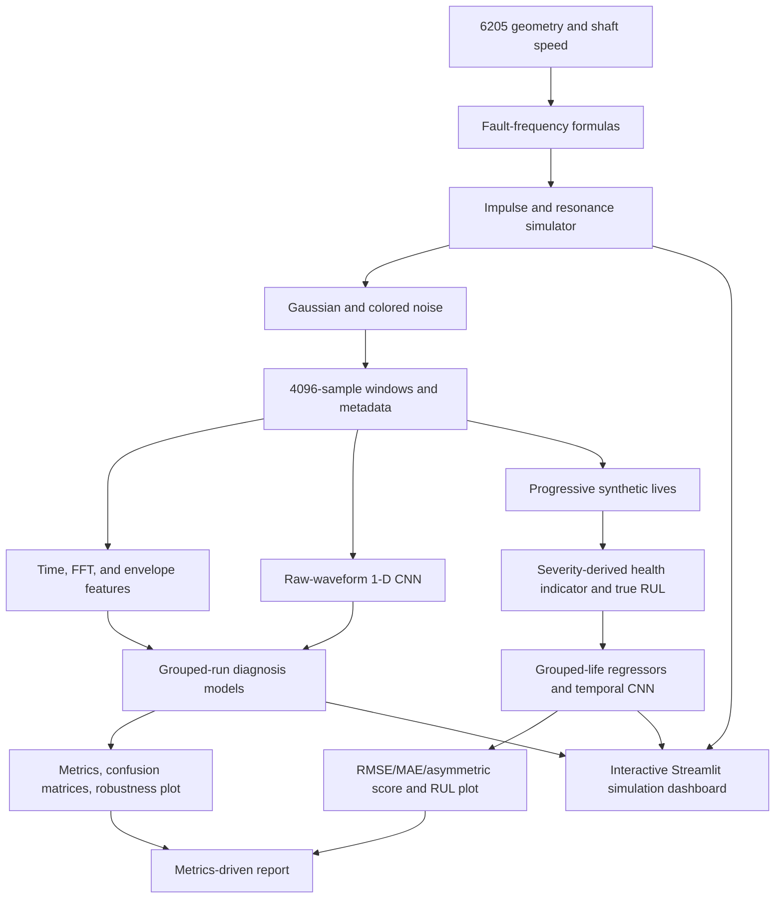

# Project Explained for the Final-Year Presentation

## 1. Problem and Industrial Relevance

A bearing supports a rotating shaft while allowing it to turn. Wear or a local crack on a raceway or rolling element can cause repeated impacts. If maintenance teams detect a fault early, they can plan inspection and replacement before a breakdown. Two common tasks are **fault diagnosis** (identify the likely fault type) and **remaining useful life, or RUL** (estimate time until a defined failure condition).

This project demonstrates a full signal-processing and machine-learning workflow using a simplified physics-based simulator. It is an educational synthetic benchmark, not a validated industrial diagnostic system. No measured bearing signal was used in its reported model scores.

## 2. Bearing and Signal Background

A deep-groove ball bearing contains an inner ring attached to the shaft, an outer ring attached to the housing, balls, and a cage that keeps the balls separated. The 6205-2RS designation refers to a sealed deep-groove bearing. The simulator assumes 9 balls, 7.938 mm ball diameter, 39.04 mm pitch diameter, and zero contact angle. The exact SKF variant and catalogue edition should be checked against the real bearing used in a rig.

A localized race or ball defect repeatedly enters a loaded contact and creates an impact. The machine housing rings at its natural structural frequencies. This simulator represents that ringing with a damped sinusoid in a 2–4 kHz band. It adds random impact timing variation and Gaussian plus low-frequency colored noise.

**Characteristic frequencies** are ideal kinematic rates at which a defect creates impacts. Let shaft frequency be $f_r = \mathrm{RPM}/60$, ball count be $n$, ball diameter be $d$, pitch diameter be $D$, and contact angle be $\theta$:

$$
\mathrm{FTF}=\frac{f_r}{2}\left(1-\frac{d}{D}\cos\theta\right)
$$

$$
\mathrm{BPFO}=\frac{n f_r}{2}\left(1-\frac{d}{D}\cos\theta\right),\qquad
\mathrm{BPFI}=\frac{n f_r}{2}\left(1+\frac{d}{D}\cos\theta\right)
$$

$$
\mathrm{BSF}=\frac{D f_r}{2d}\left[1-\left(\frac{d}{D}\cos\theta\right)^2\right]
$$

At 1,800 rpm, source code calculates BPFO 107.5505 Hz, BPFI 162.4495 Hz, BSF 70.7218 Hz, and FTF 11.9501 Hz. The existing theory prose rounds BSF to 70.75 Hz; code-calculated rounding is 70.72 Hz, a small value to correct before a formal submission.

| Label | Meaning in this project |
|---|---|
| Healthy | Shaft harmonics and noise, with no modeled defect impacts. |
| Inner Race | Impacts at BPFI, amplitude-modulated at shaft frequency. |
| Outer Race | Impacts at BPFO, with shaft-related modulation. |
| Ball | Impacts at BSF, with cage-frequency modulation. |
| Combined | Simulator API adds inner- and outer-race impulses; it is not a trained class. |

**Envelope analysis** helps reveal impact repetition. First band-pass the high-frequency resonance; then calculate the analytic signal using a Hilbert transform; take its magnitude, the envelope; and examine the envelope spectrum. The repeated-impact rate then appears at a lower frequency near BPFO, BPFI, or BSF. The regression test and a direct copy run measured peaks within 0.12% of those three expected frequencies under a seeded 5-second, high-SNR test.

## 3. Whole-System View



## 4. Data: Origin, Parameters, and Limits

The dataset was generated by `src/simulator.py`, called from `src/dataset.py` and `src/degradation.py`. The CWRU ZIP route was attempted but returned HTTP 404. Therefore the project used no downloaded real data.

| Dataset | Count | Parameters and labels |
|---|---:|---|
| Classification | 4,000 windows; 1,000 per class | 12 kHz, 4,096 samples/window, 80 simulated runs (20 per class), 4 classes; speed 1,500–3,000 rpm across windows; load and severity varied; SNR selected from 0, 5, 10, 15, 20 dB. |
| Degradation/RUL | 1,200 windows; 30 lives × 40 points | 12 kHz, 4,096 samples/window; each life is assigned a random fault among inner/outer/ball; life duration 40–100 simulated hours; severity grows toward threshold 0.90; every point has a true simulated RUL. |

A 4,096-sample window at 12,000 samples/s lasts about 0.3413 seconds. Speed and load vary between records, but each individual window uses a fixed speed and load. Degradation is an assumed exponential curve with random perturbation, not an observed bearing-failure law. The health indicator (HI) is severity plus small noise, so it is easier and more privileged than a HI extracted from real sensors.

The classification split groups by run ID: 56 train runs, 12 validation runs, 12 test runs. With 50 windows per run, this is 2,800/600/600 windows; each class has 700/150/150. The RUL split groups by complete life: 21/4/5 lives, or 840/160/200 observations. This grouping avoids placing neighboring windows from one run/life in both train and test.

## 5. Implementation Walkthrough

| File | Role and main functions |
|---|---|
| `src/simulator.py` | `fault_frequencies` calculates the four kinematic frequencies; `simulate_signal` composes shaft tones, fault impulses, modulation, decaying resonance, jitter, and noise; `expected_fault_frequency` returns the class fundamental. |
| `src/dataset.py` | `generate_dataset` creates run IDs, operating domains, labels, signals, and metadata; `save_dataset` writes the NPZ and CSV. |
| `src/degradation.py` | `simulate_life_histories` draws life duration and fault type, grows severity, forms HI/RUL labels, and synthesizes each observation; `save_life_histories` writes data. |
| `src/features.py` | `extract_features` calculates 24 vibration features; `build_feature_table` joins them to metadata; `extract_classification_features` writes `features.csv`. |
| `src/train_classification.py` | `grouped_indices` creates run-wise splits; `_fit_cnn` trains a compact waveform CNN with validation loss selection; `train_classifiers` fits four classical models, performs noise/domain checks, saves confusion plots and metrics. |
| `src/train_rul.py` | `asymmetric_rul_score` computes the currently implemented asymmetric score; `_make_sequences` builds up-to-8-observation life-local sequences; `TemporalCNN` and `train_rul_models` handle RUL prediction and artifacts. |
| `src/validate_cwru.py` | Attempts the official ZIP URL with timeout and 250 MB cap; records download status. A successful download would not by itself constitute model validation. |
| `src/result_store.py` | Merges measured model outputs into `results/metrics.json`. |
| `src/write_report.py` | Builds report tables from the saved metrics and validation status. |
| `run_all.py` | Reproduces generation, training, optional download, report writing, and pytest. |
| `app/dashboard.py` | Simulates one selectable condition, plots signal views, and loads saved sklearn models if available. |

### Feature Engineering

The implementation produces 24 signal features: 6 time-domain features, 8 spectrum features, and 10 envelope features. Classifier inputs also include RPM and load (26 total model columns). The RUL inputs include vibration features, RPM, load, and the synthetic HI (27 total columns); direct age, severity, true RUL, failure duration, and SNR are excluded.

| Feature | Meaning and physical use |
|---|---|
| RMS | Effective vibration magnitude; can rise with fault energy. |
| Fisher excess kurtosis | Emphasizes impulsive/heavy-tailed waveforms; noise and outliers affect it too. |
| Skewness | Distribution asymmetry; may change when impacts are one-sided. |
| Crest factor | Absolute peak divided by RMS; highlights isolated high peaks. |
| Peak-to-peak | Full amplitude span in the window. |
| Mean absolute value | Average magnitude independent of sign. |
| Spectral centroid | Magnitude-weighted mean frequency; summarizes spectral brightness. |
| Spectral entropy | How spread out normalized spectral power is. |
| Dominant frequency | Frequency bin with maximum magnitude. |
| Five band-energy ratios | Relative power in 0–500, 500–1500, 1500–2500, 2500–4000, 4000–6000 Hz bands. |
| Envelope RMS and centroid | Strength and frequency location after resonance demodulation. |
| BPFO/BPFI/BSF/FTF energy | Power near each speed-calculated fundamental. |
| Four harmonic energies | Power near twice each characteristic frequency. |

### Models and Training

| Model | Choice and configured training details |
|---|---|
| SVM | RBF kernel, `C=3`, balanced class weights; StandardScaler in an sklearn pipeline. |
| Random Forest classifier | 240 trees, leaf size 2, balanced class weights, all available CPU workers, seed 2026. |
| KNN | 7 neighbors, distance weights, StandardScaler. |
| Gradient Boosting classifier | 120 estimators, learning rate 0.06, max depth 2, seed 2026. |
| Classification 1-D CNN | Convolutions 1→16 (kernel 17/stride 4), 16→32 (kernel 9/stride 2), 32→64 (kernel 7/stride 2), global average pool, dense 48, dropout 0.15; Adam 0.001, cross-entropy, batch 64, 3 epochs, validation loss selection. |
| Random Forest RUL | 240 trees, minimum leaf 2, random state 2027. |
| Gradient Boosting RUL | 140 estimators, learning rate 0.04, depth 2, Huber loss, random state 2027. |
| Temporal RUL CNN | Sequence length 8, 24 and 32 convolution channels, kernel 3, global average pool, dense 24 to output; Adam 0.001, weight decay 0.0001, SmoothL1, batch 64, 18 epochs, validation loss selection. |

Classical classification selection uses validation weighted F1; RUL classical selection uses validation RMSE. The final test is used for reported estimates. A review issue is that median imputation is performed before the split in both training functions; the tested feature tables contained no missing numeric values, so it did not alter this run.

## 6. Measured Results

The values below came from the full `run_all.py` run in the verification copy. They are not real-bearing results.

### Fault Diagnosis

Test set: 600 windows from 12 held-out runs, 150 windows/class. Weighted metrics are single-label multiclass metrics.

| Model | Accuracy | Weighted precision | Weighted recall | Weighted F1 |
|---|---:|---:|---:|---:|
| SVM | 1.000 | 1.000 | 1.000 | 1.000 |
| Random Forest | 1.000 | 1.000 | 1.000 | 1.000 |
| KNN | 1.000 | 1.000 | 1.000 | 1.000 |
| Gradient Boosting | 1.000 | 1.000 | 1.000 | 1.000 |
| 1-D CNN | 0.825 | 0.848 | 0.825 | 0.821 |

All classical models had validation weighted F1 1.000. The CNN's confusion matrix has 150 healthy cases correct; of 150 inner-race cases it classified 89 correctly, 57 as outer-race, and 4 as ball; of 150 outer-race cases it classified 117 correctly and 33 as ball; of 150 ball cases it classified 139 correctly and 11 as healthy.

- `results/figures/svm_confusion.png`, `random_forest_confusion.png`, `knn_confusion.png`, and `gradient_boosting_confusion.png`: diagonal matrices with 150 correct per class and no errors.
- `results/figures/best_classifier_confusion.png`: the selected SVM's same diagonal test matrix.
- `results/figures/cnn_confusion.png`: shows the inner/outer race overlap and ball/healthy mistakes listed above.
- `results/figures/noise_robustness.png`: weighted F1 is 1.000 at every shown SNR (0, 5, 10, 15, 20 dB) for the selected classical classifier. It is not the CNN noise curve.
- `results/metrics.json` low-to-high domain experiment: 1,400 low-speed/load train windows and 2,000 high-speed/load test windows; accuracy 0.9125, weighted precision 0.9352, weighted recall 0.9125, weighted F1 0.9097.

The classical 1.000 figures are suspiciously high for bearing diagnosis, but they are genuinely what this simulator and grouped split produced. The simulator embeds each class's characteristic impulse periodicity, while all classes share the same structure and a balanced run design. The correct interpretation is synthetic class separation, not field performance.

### Remaining Useful Life

| Model | Validation selection basis | Test RMSE (h) | Test MAE (h) | Implemented asymmetric score |
|---|---|---:|---:|---:|
| Random Forest | Validation RMSE 14.0829 h | 9.9247 | 7.3702 | 1.3624 |
| Gradient Boosting | Validation RMSE 13.3968 h; selected classical model | 10.2207 | 7.6957 | 1.8596 |
| Temporal CNN | Validation loss during training | 12.7229 | 9.5061 | 2.0973 |

The RF has better held-out test error than GB, but GB is properly reported as selected by validation. Do not select RF post hoc because its test result is lower. The RUL test includes five simulated lives. `results/figures/rul_prediction.png` shows the 40-point curve for held-out life L015; the temporal CNN tracks the downward trajectory but is not a physical-life prediction. The asymmetric score's direction is internally inconsistent and needs to be explained as a limitation before discussing that column.

## 7. Dashboard

Run from the project root after dependencies and models are ready:

```powershell
python -m streamlit run app/dashboard.py
```

Choose one of the four modeled fault labels, RPM, relative load, severity, SNR, and random seed in the sidebar. The page shows a 4,096-sample waveform, its amplitude FFT, and the envelope spectrum with BPFO/BPFI/BSF/FTF marker lines. It then displays the saved classifier prediction, a classical RUL estimate, and the chosen severity value as “simulated health indicator.” In this implementation, the dashboard always generates its own synthetic input; it does not ingest a real accelerometer file or sensor stream. Its predictions must not be used for maintenance decisions.

## 8. Limitations and Real Deployment Needs

- All signals, labels, speeds, noise, and failure trajectories are simulated.
- The simulator is a hand-parameterized impulse-plus-resonance model, not a bearing contact/finite-element model.
- Speed is fixed within each short window; only records vary in speed/load.
- The failure threshold and exponential degradation law are assumptions.
- The HI is derived from hidden simulated severity; real HI engineering remains to be done.
- Only 30 independent lives (five test lives) and 80 classification runs were generated, with one seed/split.
- Perfect classical classification should be treated as a synthetic separability demonstration.
- The implemented asymmetric RUL penalty makes overestimated RUL less penalized than equally sized underestimated RUL, despite the stated aim.
- A real evaluation needs a verified dataset archive or instrumented rig, independently held-out bearings, documented sensor mounting and sampling, reference inspections, operating-condition logs, calibrated fault labels, uncertainty estimates, and repeated split/seed analysis.

## 9. Glossary

| Term | Plain-language definition |
|---|---|
| BPFO | Ball-pass frequency of the outer race. |
| BPFI | Ball-pass frequency of the inner race. |
| BSF | Ball spin frequency. |
| FTF | Fundamental train/cage frequency. |
| FFT | Fast Fourier Transform; converts a sampled signal into frequency components. |
| Envelope | Amplitude variation of a resonance-band signal, computed here using the Hilbert analytic signal. |
| SNR | Signal-to-noise ratio in decibels; larger means cleaner signal in this simulator. |
| HI | Health indicator, a scalar intended to summarize condition. Here it is simulated severity plus noise. |
| RUL | Remaining useful life, here simulated hours until severity reaches the chosen threshold. |
| Run/life grouping | Keep all windows from one simulated run or life in a single data split. |
| Precision | Of predictions assigned to a class, the fraction that are correct. |
| Recall | Of actual examples in a class, the fraction the model identifies. |
| F1 | Harmonic mean of precision and recall. |
| RMSE | Square root of mean squared RUL error; more sensitive to large errors than MAE. |
| MAE | Mean absolute RUL error. |
| Domain shift | Evaluation after operating conditions change between training and test. |

## 10. Clean-Start Commands

Windows PowerShell, from a clean project folder:

```powershell
py -3 -m venv .venv
.venv\Scripts\Activate.ps1
python -m pip install --upgrade pip
python -m pip install torch --index-url https://download.pytorch.org/whl/cpu
python -m pip install -r requirements.txt
python -m pytest -q
python run_all.py
python -m streamlit run app/dashboard.py
```

`run_all.py` regenerates files under `data/`, `models/`, `results/`, and `docs/report.md`; do not run it in a copy of results you need to preserve. To omit the network CWRU attempt, use `python run_all.py --skip-cwru`.
